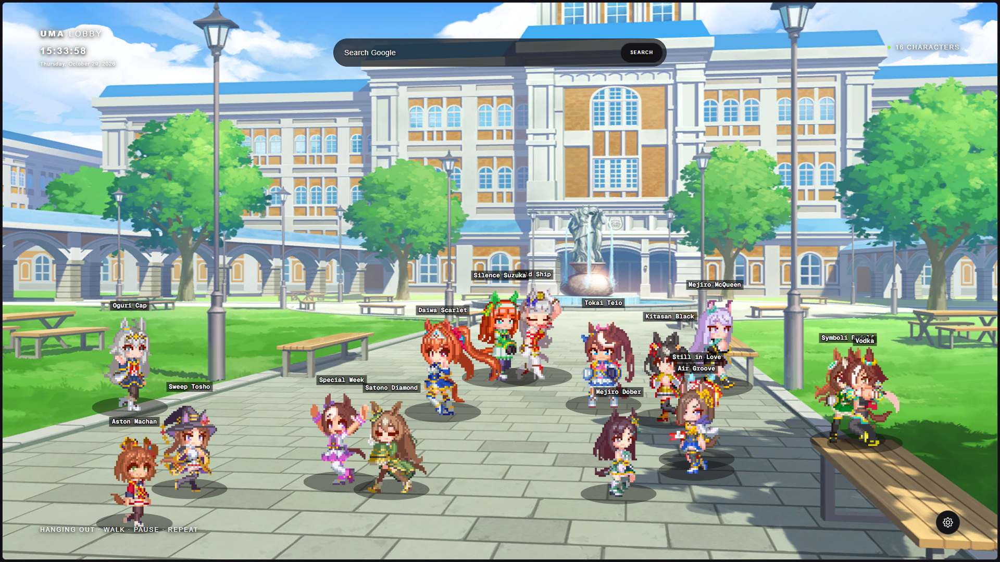
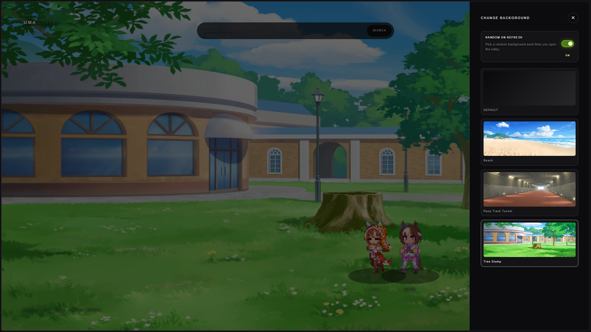
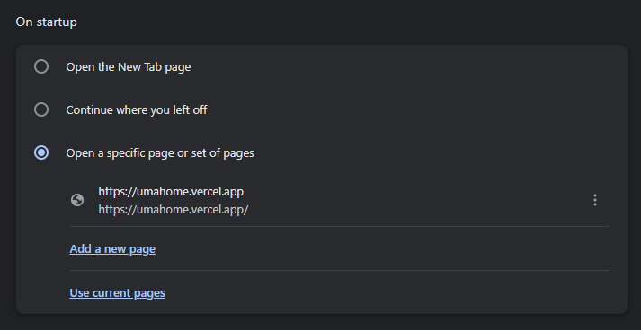
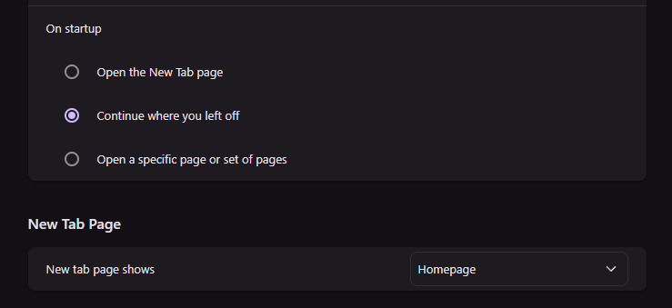
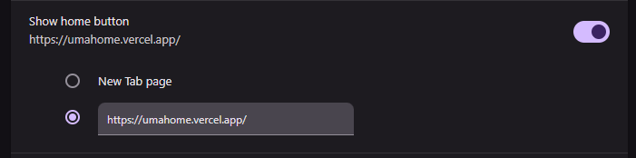

# idk, random urge to mecutin AI

## Browser Setup (Chrome)

### Chrome onStartup Settings
<chrome://settings/onStartup>

Copy and paste this link like the image:

`https://umahome.vercel.app/`

## Browser Setup (Brave)

### Brave — Change New Tab Page to Homepage
<brave://settings/>

### Go to Brave Appearance Settings
<brave://settings/appearance>

Copy and paste this link like the image:

`https://umahome.vercel.app/`

# Lobby characters (Party Dash Sprite)

The lobby automatically discovers characters from subfolders in `public/characters`. Each character folder must contain `stand`, `walk_left`, and `walk_right` .gif files (it's up to you where you get it) to appear in the scene. An optional `link.txt` containing an `http://` or `https://` URL makes that character open the link in a new tab when clicked. Characters wander in random directions, pause between walks, and remain still when reduced motion is enabled.